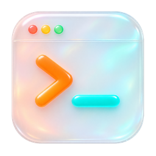
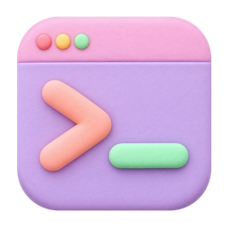
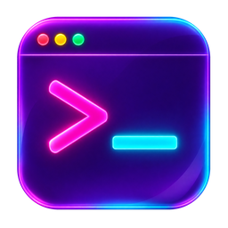
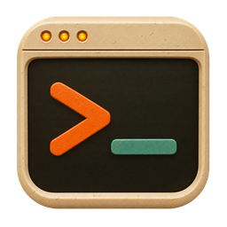
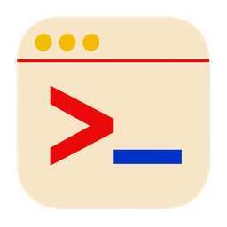

# Kookoo Terminal

## [↓ Download Kookoo for macOS](https://github.com/uuuyuqi/kookoo/releases)

**Apple silicon (M-series) · macOS 14+ · Preview**

Open the release list above, choose the newest **Pre-release**, and download its `.dmg` asset. Preview builds are not stable releases.

**No separate Ghostty installation needed.** The downloaded Kookoo app includes the libghostty terminal engine. You do not need Ghostty.app or a separate engine installation to run it. Agent CLIs (such as Codex or Claude Code) still need to be installed and signed in separately.

**Already installed?** Use **Help → Check for Updates**. Restarting stops terminal tasks; see [update verification and recovery limits](docs/updating.md).

> **Not notarized:** current builds use ad-hoc signing, not Apple Developer ID signing or notarization. macOS or company security policies may block installation. Do not disable or bypass those protections; contact your device administrator if needed.

---

A native macOS terminal for working with AI coding agents. Independently maintained, derived from [Kooky](https://github.com/iAmCorey/kooky) v0.51.12. Original Git history, copyright, MIT license and third-party notices are retained.

## Make it yours

Six of the 20 built-in alternative icons, from soft pastels to neon and minimal geometry. Choose one in **Settings → Appearance → App Icon**.

<table>
  <tr>
    <td align="center"><br>Pearl</td>
    <td align="center"><br>Marshmallow</td>
    <td align="center"><br>Neon</td>
    <td align="center"><br>Retro</td>
    <td align="center"><br>Porcelain</td>
    <td align="center"><br>Bauhaus</td>
  </tr>
</table>

## Features

- Native split terminals, multiple workspaces and the existing agent launcher.
- Fix for surviving terminal views becoming blank when a split is closed (upstream issue #89 / PR #90).
- Kookoo app icon and in-app branding.
- **⌘B** narrows or expands the left sidebar. **⌃⌘S** retains the original full/compact/hidden cycle.
- Workspace names edit directly in the sidebar: Enter saves, Escape cancels, and leaving the field saves.
- Separate application identity and data paths; existing Kooky installations are not overwritten or automatically migrated.

This project is maintained independently. There is no automatic upstream synchronization.

## Build

Requires macOS 14+, a compatible Swift 6.2+ toolchain, and full Xcode for XCTest. The initial distribution targets Apple silicon.

```sh
bash scripts/setup-libghostty.sh
swift test --build-system native
bash scripts/build-app.sh
bash scripts/build-dmg.sh
```

For source builds, [`scripts/setup-libghostty.sh`](scripts/setup-libghostty.sh) downloads the SHA-256-pinned, patched GhosttyKit archive from [Kooky v0.50.5](https://github.com/iAmCorey/kooky/releases/tag/v0.50.5). This is a build dependency, not an installed Ghostty.app dependency; Kookoo does not yet publish its own engine build.

The Ghostty engine download is pinned by SHA-256. An optional `KOOKOO_SDK=/absolute/path/to/MacOSX.sdk` selects a compatible installed SDK for app builds without changing system settings.

Outputs: `dist/Kookoo.app`, `dist/Kookoo-vX.Y.Z.dmg`.

### Signing and managed computers

The current build script uses **ad-hoc signing**, not Developer ID signing or Apple notarization. Gatekeeper or company endpoint protection may block execution. Do not disable or bypass those controls. Use an approved signed distribution or ask your device administrator where necessary.

## Data and coexistence

| Purpose | Kookoo location |
| --- | --- |
| Bundle identifier | `com.uuuyuqi.kookoo` |
| Settings | `~/.kookoo/settings.json` |
| State, helpers and socket | `~/Library/Application Support/kookoo/` |
| Logs | `~/Library/Logs/kookoo/` |
| Cache | `~/Library/Caches/kookoo/` |
| Deep links | `kookoo://` |
| Control CLI | `Kookoo.app/Contents/MacOS/kookoo-cli` |

Internal Swift module names remain `KookyKit`/`KookyHookKit`; these are implementation names, not shared user data.

Kookoo retains the upstream shell and agent hook integration, with separate Kookoo markers and paths. These hooks are installed when the app runs and can add app-managed entries to existing agent configuration. Shell control retains upstream's command-evaluation mechanism; only use trusted local clients. Agent/account credentials are not bundled or configured by the project.

The optional closed-lid privileged helper remains unchanged from upstream, is not installed by the build, and is not part of the data-isolation guarantee. Do not enable it on a managed computer without authorization.

## Validation

GitHub macOS CI runs the repository's XCTest suite, release build and bundle-signature verification before producing a DMG artifact. A successful compile is not a substitute for interactive UI or agent-provider testing. Release notes must identify any skipped or blocked checks.

## Updates

Install 0.1.3 manually once to obtain the signed-update trust anchor. Then use
Help → Check for Updates for the Sparkle update flow. Restarting stops terminal
tasks; automatic checks/downloads are off. See [update verification and recovery
limits](docs/updating.md). Apple notarization and enterprise policy restrictions
still apply.

## License and attribution

See [LICENSE](LICENSE) and [NOTICE.md](NOTICE.md). Kookoo is not the upstream project's official release. Provider names and marks identify integrations; they do not imply partnership or endorsement.

## Agent integrations

| Agent | Command | Turn attention | Tool activity | Session history |
| --- | --- | :---: | :---: | :---: |
| Claude Code | `claude` | ✓ | ✓ | ✓ |
| Codex | `codex` | ✓ | ✗ | ✓ |
| Gemini CLI | `gemini` | ✓ | ✗ | ✓ |
| OpenCode | `opencode` | ✓ | ✗ | ✓ |
| Amp | `amp` | ✓ | ✗ | ✗ |
| Cursor CLI | `cursor-agent` | ✓ | ✗ | ✓ |
| Copilot CLI | `copilot` | ✓ | ✗ | ✓ |
| Grok Build | `grok` | ✗ | ✗ | ✓ |
| Antigravity CLI | `agy` | ✓ | ✗ | ✗ |
| Kimi Code | `kimi` | ✓ | ✗ | ✓ |
| Pi | `pi` | ✓ | ✓ | ✓ |
| Oh My Pi | `omp` | ✓ | ✓ | ✓ |
| Reasonix | `reasonix` | ✓ | ✓ | ✓ |
| Kiro CLI | `kiro-cli` | ✗ | ✗ | ✓ |
| Droid | `droid` | ✓ | ✗ | ✓ |
| Devin CLI | `devin` | ✓ | ✗ | ✗ |
| Qoder CLI | `qoder` | ✗ | ✗ | ✗ |
| Qoder CN CLI | `qodercn` | ✗ | ✗ | ✗ |
| Qoder CLI (Legacy) | `qodercli` | ✗ | ✗ | ✗ |

Qoder CLI and Qoder CN CLI launch the locally installed `qoder` and `qodercn` respectively. They do not switch accounts or install software. Ask uses `--prompt-interactive`; legacy `qodercli` is launch-only and is not offered in Ask. These integrations currently show process start/exit, not turn-level status, tool activity or session-history import. Install and sign in using the official Qoder documentation. New Qoder desktop and Qoder CLI are distinct products; Kookoo hosts the CLI, not the desktop UI.
